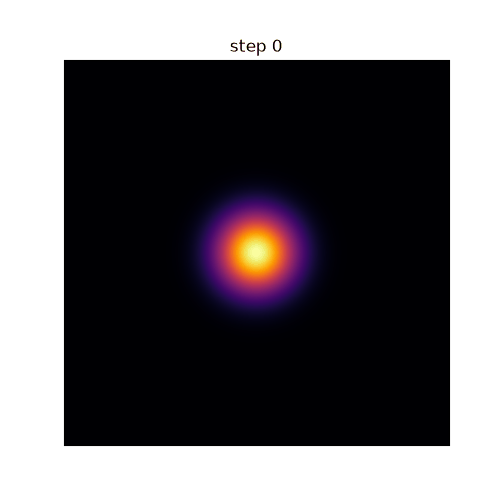
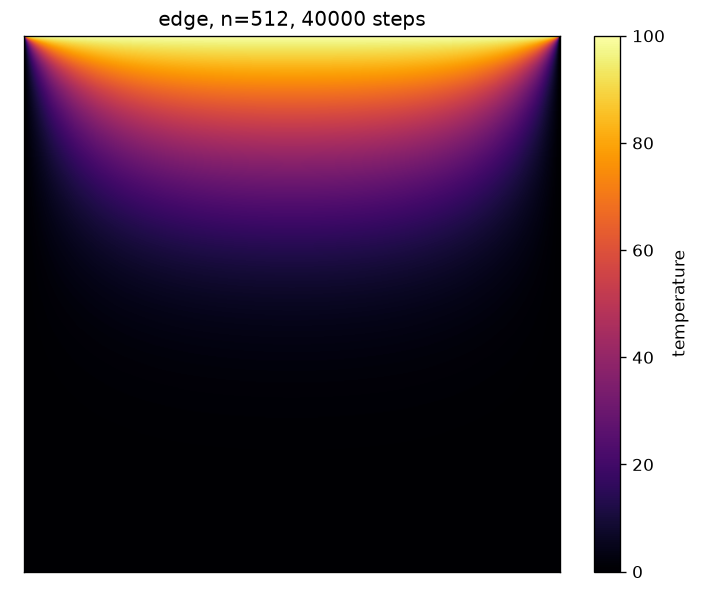
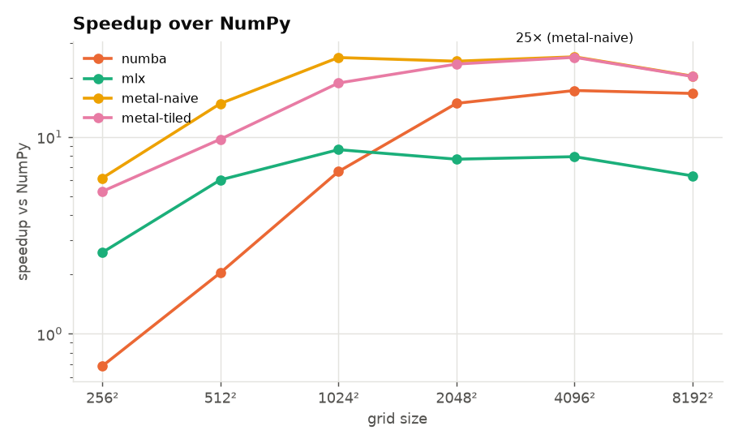
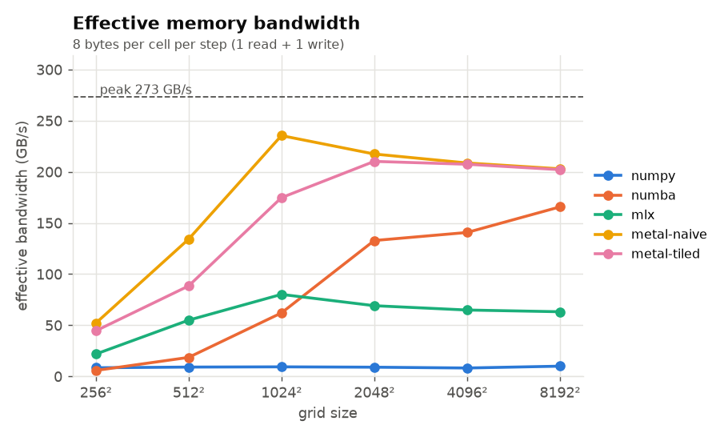
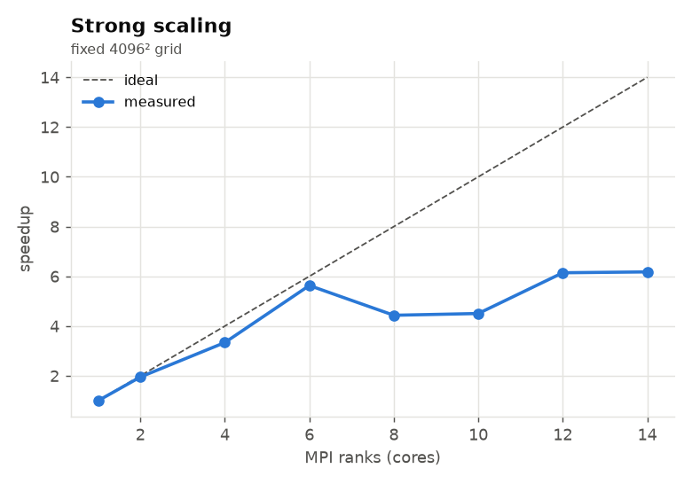
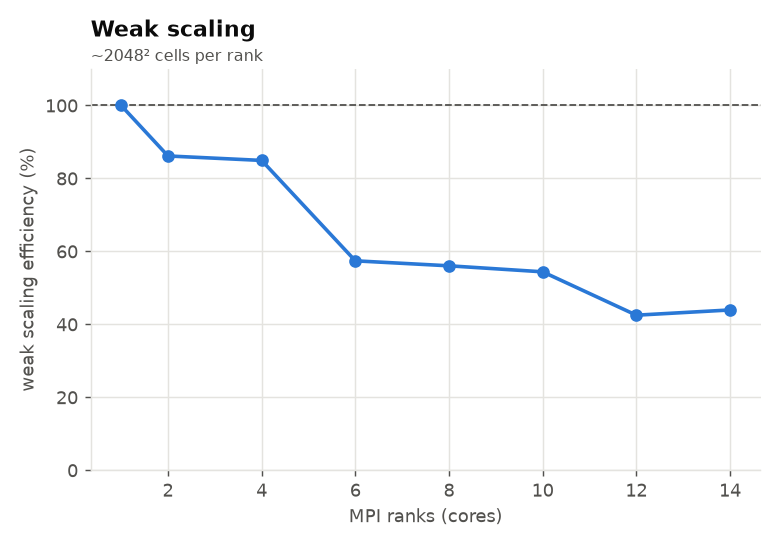

# heatsim: 2D heat diffusion on CPU, Apple GPU and MPI

A 2D heat equation solver written five different ways: NumPy, multithreaded Numba, plain MLX, and two hand-written Metal kernels. On top of that there's an MPI version with 2D domain decomposition, and a small job service with Prometheus/Grafana monitoring.

The heat equation stencil is the standard memory-bound HPC benchmark. Each cell does very little math and a lot of loads and stores, so the question is how close each version gets to the hardware's memory bandwidth.

Everything runs locally on an M4 Pro MacBook (14 CPU cores: 10 performance + 4 efficiency, 20-core GPU, 273 GB/s unified memory).

<p align="center">
  
  
</p>

## The math

$$\frac{\partial u}{\partial t} = \alpha \left(\frac{\partial^2 u}{\partial x^2} + \frac{\partial^2 u}{\partial y^2}\right)$$

Discretized with forward Euler in time and the 5-point Laplacian in space (FTCS):

```
u'[i,j] = u[i,j] + r * (u[i-1,j] + u[i+1,j] + u[i,j-1] + u[i,j+1] - 4*u[i,j]),   r = α·dt/dx²
```

It's only stable for `r <= 0.25`, so everything defaults to `r = 0.24`. The boundary is Dirichlet (edge cells are held fixed). Everything is float32 because Metal has no float64.

`tests/test_solvers.py` checks every backend against NumPy, and also checks NumPy against an exact solution: `sin(πx)·sin(πy)` is an eigenmode of the discrete Laplacian, so it should decay by exactly `1 - 8r·sin²(π·dx/2)` per step.

## Backends

| backend | what it is |
|---|---|
| `numpy` | vectorized slicing. Single threaded, allocates temporaries every step |
| `numba` | `@njit(parallel=True)`, rows split across cores with `prange` |
| `mlx` | the same slicing written in MLX and wrapped in `mx.compile` |
| `metal-naive` | custom Metal kernel, one thread per cell, each thread reads its 5 neighbours from device memory |
| `metal-tiled` | each threadgroup loads a `(TY+2)×(TX+2)` tile (with a 1-cell halo) into `threadgroup` memory, barriers, then computes from the tile |

The Metal kernels are in `heatsim/solvers/metal_solver.py` and are launched through `mx.fast.metal_kernel`. Threadgroup memory is Metal's version of CUDA `__shared__` memory, and `threadgroup_barrier` is `__syncthreads()`. The tiled kernel pads the grid up to a multiple of the tile size so every threadgroup is full. Out-of-range threads still help load the tile and just skip the write, because returning early before the barrier would be a bug.

## Setup

```bash
make setup                 # creates .venv and installs everything
source .venv/bin/activate
make test
```

MPI comes from the `mpich` pip package, which puts `mpirun` inside the venv, so no Homebrew is needed.

## Running it

```bash
python -m heatsim backends
python -m heatsim run --backend metal-tiled --n 2048 --steps 5000 --png results/out.png
python -m heatsim run --n 512 --steps 20000 --init edge --gif results/edge.gif
```

Initial conditions: `hotspot` (Gaussian in the middle), `edge` (top edge held at 100), `rings`, `random`.

## Phase 1: single device

```bash
make bench          # all backends, 256² .. 8192², writes results/single.csv
make bench-tiles    # threadgroup shape sweep for the metal kernels
make plots          # results/plots/*.png
```

Effective bandwidth counts 8 bytes per cell per step (one float read, one float written). That's the minimum possible traffic, so it's a lower bound and the standard way to report stencil performance.

**Results (M4 Pro):** _fill in after running `make bench`_

| backend | 1024² ms/step | 4096² ms/step | 4096² GB/s | % of 273 GB/s | speedup vs NumPy |
|---|---|---|---|---|---|
| numpy | | | | | 1× |
| numba | | | | | |
| mlx | | | | | |
| metal-naive | | | | | |
| metal-tiled | | | | | |




Things I noticed:

- Small grids (256²) are dominated by overhead. Numba's thread startup is slower than single-threaded NumPy there, and the GPU kernels are limited by launch latency, not memory.
- `mlx` (high-level ops) sits well below the hand-written kernels. Even with `mx.compile`, the slicing and concatenating to rebuild the boundary costs extra passes over memory.
- Tiling on Apple GPUs helps less than it does on NVIDIA. The GPU cache already catches most of the neighbour reuse, so naive and tiled end up close at large sizes. Tiling is still worth having, but the gap depends heavily on grid size and threadgroup shape (see `make bench-tiles`).
- At 4096² and up, the working set (2 × 64 MB) is bigger than the on-chip caches, so this is where the bandwidth number really means DRAM bandwidth.

## Phase 2: MPI domain decomposition

`heatsim/mpi_solver.py` splits the global grid over a `px × py` Cartesian process grid (`MPI.Compute_dims`). Each rank keeps its block plus a 1-cell ghost layer. Every step:

1. **Halo exchange.** `Sendrecv` with the up/down/left/right neighbours. Rows are contiguous and sent straight from the array; columns are packed into buffers first. Ranks on the outer edge get `MPI.PROC_NULL` as a neighbour, so those calls are no-ops.
2. **Update.** A serial Numba kernel updates the owned cells, skipping the physical boundary.

```bash
mpirun -n 4 python -m heatsim.mpi_solver --n 2048 --steps 500 --verify   # checks against serial numpy
make scaling    # strong + weak sweep over 1..14 ranks, writes results/mpi.csv
make plots
```

Each rank is pinned to one thread (`NUMBA_NUM_THREADS=1`), so ranks equal cores.

- **Strong scaling:** fixed 4096² grid, more ranks.
- **Weak scaling:** 2048² cells per rank, so the global grid grows like `2048·√p`.

**Results:** _fill in after running `make scaling`_

| ranks | strong speedup | strong efficiency | weak efficiency | halo % |
|---|---|---|---|---|
| 1 | 1.0 | 100% | 100% | |
| 2 | | | | |
| 4 | | | | |
| 8 | | | | |
| 10 | | | | |
| 14 | | | | |




Things to keep in mind when reading these numbers:

- This is shared-memory MPI on one chip. All ranks compete for the same 273 GB/s, and since the stencil is memory-bound, efficiency drops once a few cores are enough to saturate bandwidth. That isn't the communication cost; the halo % chart shows how much time actually goes to communication.
- Past 10 ranks you're on the efficiency cores, which are a lot slower, and the slowest rank sets the pace for everyone.
- On a real cluster, each node brings its own memory bandwidth, so weak scaling across nodes should look much better than this. The code doesn't change, only the `mpirun` line.

## Phase 3: job service + monitoring

A FastAPI service that accepts simulation jobs, runs them in a process pool, and exposes Prometheus metrics. Grafana has a provisioned dashboard showing throughput, runtime percentiles, queue depth/wait, and estimated cost per run.

```bash
make up            # docker compose: api (:8000) + prometheus (:9090) + grafana (:3000)
make load          # fire random jobs at it
open http://localhost:3000
```

```bash
curl -X POST localhost:8000/jobs -H 'content-type: application/json' \
     -d '{"n": 1024, "steps": 5000, "init": "hotspot"}'
curl localhost:8000/jobs/<id>
open http://localhost:8000/jobs/<id>/image
```

API docs are at `http://localhost:8000/docs`.

**Metal inside Docker:** Docker on macOS runs a Linux VM with no access to the GPU, so the containerized API falls back to the `numba` backend. To serve GPU jobs, run the API natively with `make serve` (port 8001). The Prometheus config already scrapes `host.docker.internal:8001`, so native jobs show up on the same dashboard under `job="heatsim-native"`. Try `python scripts/load_test.py --url http://localhost:8001` and compare the two.

**Cost per run:** running locally is free, so the service multiplies runtime by `HEATSIM_COST_PER_HOUR` (default $0.53/h, about the price of a small on-demand cloud GPU instance) to show what the same workload would cost if it were rented.

| metric | type |
|---|---|
| `heatsim_jobs_submitted_total{backend}` | counter |
| `heatsim_jobs_finished_total{backend,status}` | counter |
| `heatsim_jobs_queued`, `heatsim_jobs_running` | gauge |
| `heatsim_job_runtime_seconds{backend}` | histogram |
| `heatsim_job_queue_wait_seconds` | histogram |
| `heatsim_cell_updates_total{backend}` | counter (rate gives MLUPS) |
| `heatsim_job_cost_dollars{backend}` | histogram |

## Layout

```
heatsim/
  grid.py            config + initial conditions
  solvers/           numpy, numba, mlx/metal backends behind one interface
  mpi_solver.py      2D domain decomposition + halo exchange
  __main__.py        CLI
benchmarks/          single-device, tile sweep, MPI scaling, plotting
service/             FastAPI app, job queue, prometheus metrics
monitoring/          prometheus + grafana provisioning and dashboard
scripts/             scaling sweep, load generator
tests/
```

## Ideas for later

- Temporal blocking: do several timesteps per kernel launch while the tile is in threadgroup memory.
- Overlap the halo exchange with the interior update (`Isend`/`Irecv`, update the interior, wait, then update the edges).
- Run the MPI version on a real cluster with Slurm.
- A CUDA version of the tiled kernel (CuPy `RawKernel`) to compare against an NVIDIA GPU.
